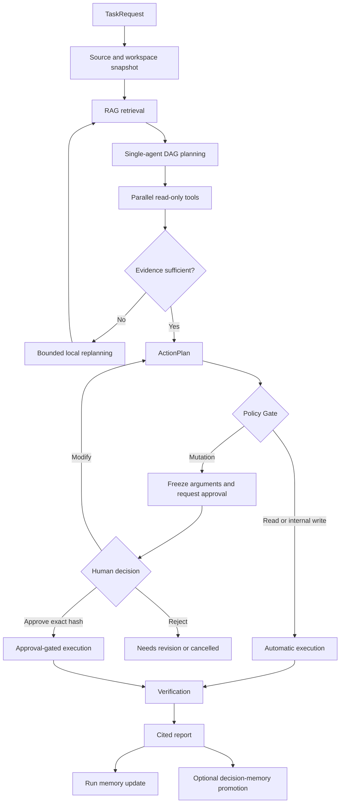
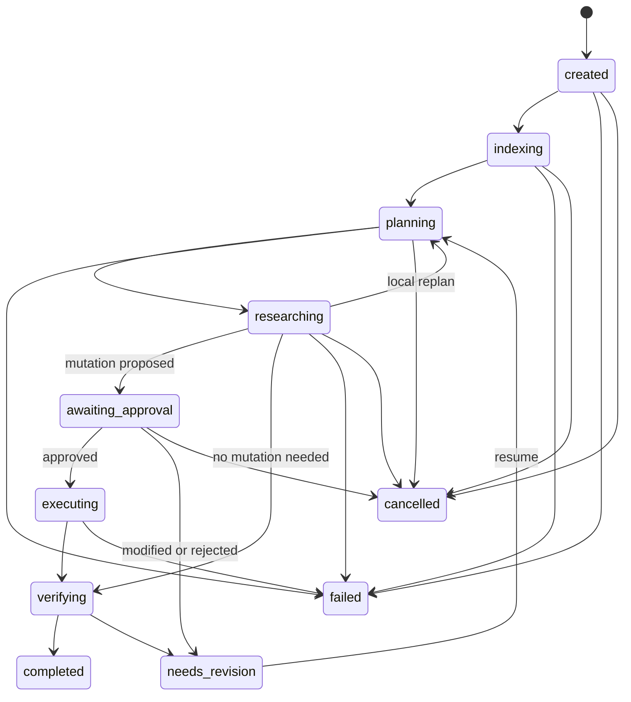

# TracePilot Architecture

## 1. 定位与边界

TracePilot 是一个本地优先、证据驱动的通用技术研究与决策单 Agent。它接收技术目标和本地 workspace，将网页、冻结资料、本地文档与源码组织为可追溯证据，生成带依赖关系的执行计划，并在人工批准后执行可能改变外部状态的操作。

TracePilot 为独立设计与实现的项目。

默认任务包括：

- 依赖升级
- API 迁移
- 架构选型
- 测试或运行时故障诊断

BioML 不进入通用内核。它作为 `taskpacks/bioml` 下的可插拔领域示例保留，用于验证兼容性和 taskpack 扩展方式。

当前版本是单机、本地实现。SQLite 适合当前的持久化与任务隔离需求；系统不宣称已完成线上多租户、分布式调度或大规模部署。

## 2. 总体流程



这个流程把“研究与建议”和“真正改变环境”分开。模型可以自主读取、检索和组织证据，但不能绕过 Policy Gate 修改用户文件、执行任意命令或写入外部服务。

## 3. 五模块内核

### 3.1 LLM Gateway

LLM Gateway 隔离模型供应商和业务运行时，负责：

- 结构化输入输出
- 模型、Prompt 与 schema 版本记录
- 有上限的重试
- token、延迟和成本元数据
- provider 错误标准化
- 确定性测试实现

默认实现不需要外部模型和凭据。可选 `[llm]` extra 提供 OpenAI Responses API 适配器，但计划、工具与执行模块不直接依赖供应商 SDK。

### 3.2 Planning Engine

Planning Engine 将目标转换为 `TaskPlan`，其中 `PlanStep` 形成 DAG：

- 单次计划最多 20 个步骤
- 完整任务最多 3 轮规划
- 最多并行执行 4 个无依赖只读步骤
- mutation 不和其他步骤并行
- 计划生成后先验证 step id、依赖存在性、环和 effect 约束
- 证据不足或局部工具失败时只重规划受影响部分

并行 DAG 是执行调度策略，不等于 Multi-Agent。所有步骤共享同一任务上下文、证据集合、策略和 trace。

### 3.3 Memory Store

Memory Store 使用 SQLite WAL，区分三类数据：

| 类型 | 写入时机 | 可变性 | 默认召回范围 |
| --- | --- | --- | --- |
| Working memory | 每个成功步骤后 | 随任务 checkpoint 更新 | 当前 task |
| Run memory | 完成或失败时 | 追加，不覆盖历史 | 同一 workspace |
| Decision memory | 用户明确 promote 后 | 可 stale、disable、supersede 或 delete | 同一 workspace |

知识索引与 Agent 记忆使用不同表和接口。网页或源码 chunk 是可引用证据，不会因为被检索过就自动变成长期记忆。

Decision memory 的维护规则：

- 内容哈希用于抑制重复写入。
- 召回结果只作为规划提示，触发 `verify_decision_memory` 基于当前索引补证；memory 本身不能成为 `EvidenceClaim` 的引用来源。
- workspace commit、文件哈希或来源版本变化时，相关记录标为 `stale`。
- stale 和 disabled 记录默认不参与召回。
- 新结论通过 `supersedes_id` 指向旧记录，保留审计链。
- 不自动记录用户画像、个人偏好或跨 workspace 推断。

### 3.4 Tool Registry

每个工具必须声明完整契约：

```text
name
description
input schema
output schema
effect_class = read | internal_write | mutation
timeout
idempotency behavior
required permissions
state dependencies
```

缺少 `effect_class` 的工具注册失败。首批通用工具包括：

| 工具 | Effect | 用途 |
| --- | --- | --- |
| `web_search` | `read` | 搜索公开技术资料 |
| `fetch_url` | `read` | 获取并解析指定 URL |
| `index_workspace` | `internal_write` | 为本地 workspace 建立知识索引 |
| `search_index` | `read` | 检索混合索引 |
| `read_file` | `read` | 在限定 workspace 内读取文件 |
| `search_code` | `read` | 搜索符号和代码文本 |
| `inspect_git` | `read` | 检查 commit 与工作树状态 |
| `propose_patch` | `internal_write` | 只生成 ActionPlan artifact |
| `apply_patch` | `mutation` | 修改用户文件 |
| `run_command` | `mutation` | 执行限定命令 |

### 3.5 Execution Runtime

Execution Runtime 对计划步骤执行二次策略检查：

- `read` 可以自动执行。
- `internal_write` 只能写入 trace、index、checkpoint 或内部 artifact。
- `mutation` 必须创建 `ApprovalRequest`。
- 审批记录绑定工具名、参数、workspace、step 和参数哈希。
- 运行前重新计算哈希；任何变化都会阻止执行。
- 文件型参数必须位于批准的 workspace；命令使用冻结 argv 并以 workspace 为工作目录。
- 结构化 patch 强制携带 `expected_sha256`，并在真正写入前再次检查内容与存在状态。
- mutation 不自动重试，避免重复副作用。
- 幂等键用于阻止同一批准操作被重复执行。
- 执行结果进入验证步骤，而不是直接视为任务成功。
- mutation 不使用不可取消的 Python 线程超时；自定义 mutation 必须实现可取消超时，内置命令工具会在超时时终止进程组。

`run_command` 的 v1 边界是审批、参数冻结和工作目录约束，不宣称操作系统级进程沙箱；不可信命令需要外部容器或 sandbox profile。

## 4. 完整 RAG

### 4.1 来源接入

RAG 支持三类输入：

- 联网搜索结果或显式 URL
- 本地项目中的源码、配置和文档
- benchmark 使用的冻结来源快照

每个 `SourceDocument` 保存 document id、URI、本地路径或 URL、标题、内容哈希、来源版本和自定义元数据。实时 provider 与 frozen provider 使用同一文档接口，因此可信回归测试不依赖网络。

### 4.2 分块和索引

结构化分块优先保留语义边界：

- Markdown 标题与段落
- 源码文件、符号和行号
- 配置项与相邻说明
- 普通文本的段落和受限窗口

每个 `EvidenceChunk` 记录稳定 chunk id、source id、文本、内容哈希、标题路径、页码或文件行、来源版本及 poisoning 标志。

索引写入 SQLite：

- FTS5 提供 BM25 词法召回
- embedding 表提供向量召回
- 内容哈希完成去重和增量更新
- source/version 字段支持过期标记

默认确定性 embedder 用于离线测试；provider 接口允许替换为外部 embedding 服务。

### 4.3 检索和重排

```text
Task goal
  -> query decomposition
  -> BM25 Top-20
  -> vector Top-20
  -> duplicate removal
  -> rank fusion
  -> structured rerank
  -> Top-8 context
```

确定性重排综合 RRF 排名、查询词覆盖、来源多样性和 poisoning 风险标记；stale 来源默认在召回阶段排除。被识别为潜在 prompt injection 的内容可以作为普通数据留在审计记录中，但不会作为指令控制 Agent。

文档、chunk、alias 与 stale 更新都带 workspace namespace。同一 SQLite 文件可服务多个任务，但本地或外部证据不会跨 workspace 召回；workspace id 还会持久绑定到规范化路径，避免调用方把同一逻辑 id 复用于两个目录。

### 4.4 生成和校验

最终输出先生成 `EvidenceClaim`，再渲染为报告。每条可验证事实必须绑定一个或多个 chunk id，并保留页码、URL 或文件行定位。

校验包括：

- citation coverage：支持性事实是否都有引用
- faithfulness heuristic：逐 clause 的高阈值词项覆盖，以及数字、否定和 poisoning 一致性
- source drift：来源版本是否已改变
- poisoning：引用内容是否包含试图改变 Agent 行为的指令

无法获得足够支持时，系统标记不确定性或 abstain。它不会用 decision memory 代替当前证据，也不会把模型常识伪装成来源结论。

当前离线校验是保守的词法启发式，不宣称等价于语义蕴含模型；严格生产场景应接入独立 entailment verifier。

## 5. 核心模型

| 模型 | 作用 |
| --- | --- |
| `TaskRequest` | 用户目标、workspace、来源与执行偏好 |
| `TaskContext` | workspace/source 快照和任务级约束 |
| `TaskPlan` | 经过验证的步骤 DAG |
| `PlanStep` | 单个工具或综合步骤及其依赖和 effect |
| `SourceDocument` | 原始来源及其版本和 provenance |
| `EvidenceChunk` | 可检索和可引用的最小证据单元 |
| `EvidenceClaim` | 报告事实及其 chunk 引用 |
| `ToolResult` | 结构化工具输出、错误和执行元数据 |
| `ApprovalRequest` | 冻结 mutation 及其审批状态 |
| `MemoryRecord` | workspace-scoped 记忆记录 |
| `AgentRun` | 一次任务的当前持久状态 |
| `TraceEvent` | 只追加的状态和执行事件 |

任务生命周期为：



## 6. 持久化与恢复

SQLite 至少承载以下逻辑数据：

- tasks and current run state
- checkpoints
- immutable trace events
- tool results
- approval requests and idempotency keys
- working, run, and decision memory
- source documents, chunks, FTS index, and embeddings

每个成功步骤后写 checkpoint。服务重启后，运行时从持久化 task 与 checkpoint 状态恢复未完成任务；不同 task/session 不共享 working state。

新 checkpoint 使用 `schema_version=2`。兼容层把已知 v1 BioML checkpoint 映射为通用 `TaskRequest`、`TaskContext` 与 trace；未知版本明确报错，不进行猜测式迁移。

## 7. 接口与 Workbench

### 7.1 CLI

```text
tracepilot ingest
tracepilot run
tracepilot resume
tracepilot approve
tracepilot memory list
tracepilot memory promote
tracepilot memory supersede
tracepilot memory delete
tracepilot serve
```

`resume`、`approve` 和 `memory` 子命令跨进程定位状态时，需要显式传入相同的 `--workspace-id` 与 `--db`：

```bash
tracepilot resume TASK_ID \
  --workspace-id WORKSPACE_ID --db .tracepilot/tracepilot.db
tracepilot approve TASK_ID APPROVAL_ID --decision approved \
  --workspace-id WORKSPACE_ID --db .tracepilot/tracepilot.db
tracepilot memory list \
  --workspace-id WORKSPACE_ID --db .tracepilot/tracepilot.db
```

### 7.2 HTTP API

FastAPI 是可选 `[api]` extra。公开边界覆盖：

- 创建和读取任务
- 获取任务列表
- SSE 读取 append-only 事件
- 提交审批决策
- 恢复任务
- 获取报告、patch 和日志等 artifact
- 查看、提升、替代与删除 memory

API 和 CLI 调用同一 runtime，不各自实现一套策略。

### 7.3 Web Workbench

Workbench 使用 FastAPI、服务端 HTML 与轻量 JavaScript/SSE，不引入独立 React 工程或消息队列。主要视图包括：

- 任务列表和当前状态
- DAG 步骤与时间线
- EvidenceChunk 和引用跳转
- memory 状态与维护操作
- mutation 参数、命令或 patch 预览
- 批准、修改与拒绝操作
- 执行日志、验证结果和最终报告

## 8. 为什么不是 Multi-Agent

当前问题更需要共享证据、严格权限和可恢复执行，而不是角色数量。单 Agent 加 DAG 的选择基于以下理由：

- 独立检索步骤已经可以并行，不需要复制 Agent。
- 一个上下文和一个证据账本更容易保证引用一致。
- mutation 只有一条审批链，权限判断更清楚。
- checkpoint、局部恢复和幂等处理更简单。
- benchmark 可以直接归因到规划、检索或工具模块。
- 减少 token、延迟和多 Agent 协调失败。

Multi-Agent 不是永久排除，而是带验证门槛的后续选项：只有单 Agent benchmark 暴露稳定瓶颈，并且 A/B 测试证明质量收益大于成本和复杂度时才引入。

## 9. Taskpack 与兼容层

通用核心不认识 BioML 类型。领域扩展通过 taskpack 提供：

- 领域 schema 和验证器
- 领域工具
- fixture 和 benchmark
- 报告模板或补充规则

`tracepilot.taskpacks.bioml` 是第一个示例。兼容期内保留：

- `bioml_agent` import
- `bioml-agent` 与旧辅助 CLI
- v1 checkpoint 映射
- 历史 benchmark 与 fixture

兼容层不影响通用默认流程，也不作为新作品集指标的主要来源。

所有报告、trace、数据库、缓存和工作台导出文件都可由命令重新生成，因此不纳入版本控制。

## 10. 测试与评测边界

通用回归集使用冻结网页快照和小型本地仓库，覆盖四类技术任务。测试重点是：

- RAG 解析、分块、去重、混合召回、重排和引用定位
- 索引增量更新、来源漂移、冲突与 prompt injection
- claim citation coverage、faithfulness 和 abstention
- memory checkpoint、重复抑制、supersede、stale、删除与 workspace 隔离
- DAG 合法性、只读并行、补搜、局部失败恢复和轮次上限
- mutation 审批、参数哈希、幂等键和禁止自动重试
- SQLite 重启恢复与 task/session 隔离
- Workbench 桌面/移动布局、SSE、引用跳转和审批交互

评测设计比较 one-shot LLM、单查询 RAG 与完整 TracePilot 三类路径，但具体结果只能来自已完成的本地运行记录。文档不预先写入未经验证的分数、部署规模或业务收益。

## 11. 明确不做的事情

本地 v1 暂不引入：

- 自动跨任务、跨 workspace 的用户偏好记忆
- 无审批的文件修改、任意命令或外部写操作
- PostgreSQL、Kafka、Kubernetes 或分布式 worker
- 装饰性的角色 Multi-Agent
- 依赖实时网络才能通过的回归测试
- 将 BioML 领域逻辑重新放回通用核心

这些边界让项目把重点放在可解释的规划、完整证据链、记忆维护和可控执行，而不是为展示技术名词增加没有验证价值的复杂度。
